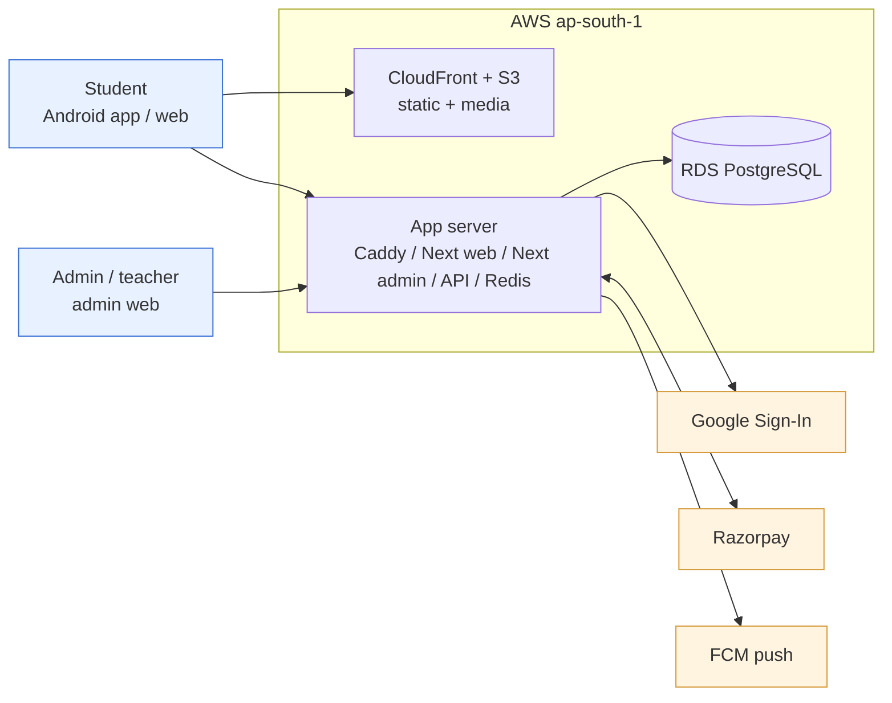
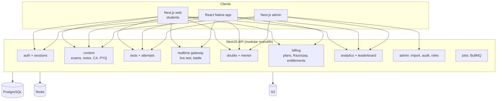
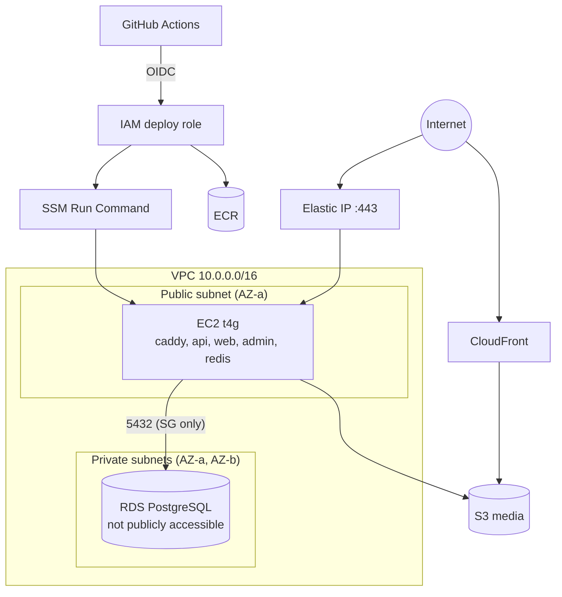

# ExamGadh – Architecture & Design

**DRAFT — pending client approval.** Step 2 of the SDLC pipeline. Build (step 3) stays locked until the client approves this document.

## 1. Summary and decisions

ExamGadh is a Hindi/English exam-prep platform for CGPSC and CG Vyapam aspirants: tests (static and live), notes, PYQs, current affairs, analytics, doubts, 1v1 battle, study planner and interview prep, sold by subscription through Razorpay. The first-year scale is small (2k monthly active users, 300 concurrent on a live test), the budget is Rs 5,000–15,000/month, and the team is two people. The design is therefore deliberately plain: **one TypeScript backend, one PostgreSQL database, one small server per environment**, no Kubernetes, no microservices.

| # | Decision | Choice | Alternative rejected | Reason |
|---|---|---|---|---|
| D1 | Cloud / region | AWS Mumbai (ap-south-1) | Other cloud; other region | India data residency and latency for CG users; user expects AWS (pipeline default) |
| D2 | Backend | NestJS (Node 22, TypeScript) modular monolith, REST + WebSocket | Python/Django; microservices | One language across web, mobile and backend (shared types); WebSocket for live test/battle in the same process; 2-person team |
| D3 | Database | PostgreSQL 16 on RDS | DynamoDB; MongoDB | Relational content (exam→subject→topic→question→test), joins for analytics, JSON columns for bilingual question bodies; see §5.3 |
| D4 | Cache / realtime state | Redis 7 in a container on the app server | ElastiCache | ElastiCache costs ~Rs 1,100+/month extra at the smallest size; Redis here holds only rebuildable data (sessions index, battle queue, leaderboards, rate limits) |
| D5 | Compute | One EC2 t4g instance per environment (Docker Compose: api, web, admin, redis, caddy), auto-recovery enabled | ECS Fargate + ALB; Kubernetes | ALB alone is ~Rs 1,800/month; at 300 peak concurrent a single instance is enough; simple to run for 2 people |
| D6 | Web | Next.js (student app + a separate admin app) | One Next.js app with /admin | Admin is a different trust boundary: own hostname, 2FA, optional IP allow-list |
| D7 | Mobile | React Native with Expo (development build / EAS) | Bare RN; Flutter | Razorpay's RN SDK needs native code, which Expo dev builds support via a config plugin; code sharing with web |
| D8 | Auth | Google Sign-In (OIDC ID token verified server-side) + own short-lived JWT + server-side session record. **No phone number at launch** (user decision) | Phone OTP; Firebase Auth | Single-active-session rule needs sessions the server controls; no SMS cost |
| D9 | Payments | Razorpay only (Orders API, Checkout web / RN SDK, signed webhooks) | Play Billing; other gateways | User decision. Risk: Play policy (see §9) |
| D10 | Files | S3 + CloudFront (notes images, PYQ PDFs, doubt photo/voice, CA cards) | Store in DB | Cheap, cacheable; pre-signed uploads |
| D11 | IaC / CI | Terraform; GitHub Actions with OIDC to AWS (no long-lived keys) | Console clicks; CDK | Repeatable `dev` now, `prod` later from the same modules |
| D12 | Environments | **dev now, prod later** (user decision); no always-on staging | dev+staging+prod | Saves cost during development. Dev doubles as the pre-prod test bed until prod exists |
| D13 | Push | Firebase Cloud Messaging | SNS mobile push | Free, standard for RN |
| D14 | Background jobs | BullMQ on the same Redis | SQS + Lambda | One less AWS service; jobs are light (notifications, SLA timers, result ranking, reports) |

## 2. Sizing inputs and assumptions

Answers from the sizing interview (2026-10-27):

| Input | Value | Source |
|---|---|---|
| Registered users, 12 months | 5,000 | user (option "Small") |
| Monthly active users | 2,000 | user |
| Peak concurrent (live test) | 300 | user |
| Monthly infra budget | Rs 5,000–15,000 (target, not hard cap) | user |
| Availability target | 99.5% (~3.6 h/month), no on-call rota, 2-person team | user |
| Region | Mumbai | assumed (not objected to) |
| Environments | dev first, create prod later | user |
| Phone number | none at launch | user |

Assumptions (derived, to be validated at load test, step 5):
- A live test of 100 questions with 300 users: each answer sync is a small write; ≈ 300 × (1 write / 20 s) ≈ 15 writes/s peak, plus the start/submit spike (≈ 300 requests in the first 10 s). One 4-GB instance handles this comfortably.
- Question data: 20,000 questions × ~2 KB bilingual ≈ 40 MB. Notes and PYQ PDFs ≈ 2 GB in S3. Attempts: 2,000 MAU × 20 tests × 100 answers = 4 M `attempt_answers` rows/year ≈ 1–2 GB. Everything fits in a 20–50 GB database.
- Reads:writes ≈ 90:10 outside live tests; content is read-heavy and cacheable (CloudFront, Redis).
- Peak days (exam week, results) may be 3× normal; instance can be resized in minutes.
- Retention: attempts kept for the life of the account; audit log 12 months; backups 7 days (dev), 14 days (prod).
- Growth beyond 10k MAU or 1,000 concurrent: split web from API onto a second instance, add read replica; no redesign needed.

## 3. System context and components

Module boundaries are folders with explicit interfaces inside one deployable. Splitting later (for example, realtime) is possible but not planned.

## 4. Infrastructure (AWS)

- **Network:** one VPC, 2 AZs defined (needed by RDS subnet groups). Public subnet: the app instance (Elastic IP, security group allows 80/443 from CloudFront ranges and the world for the API host). Private subnets: RDS (no public access, only the app SG on 5432).
- **Compute:** EC2 `t4g.medium` (2 vCPU, 4 GB, ARM) in prod; `t4g.small` in dev, stopped nights/weekends by a schedule. Docker Compose runs `caddy` (TLS via Let's Encrypt), `api`, `web`, `admin`, `redis`. Instance recovery alarm restarts on hardware failure. Deploy via GitHub Actions → ECR → SSM Run Command (no SSH).
- **Database:** RDS PostgreSQL `db.t4g.small` prod / `db.t4g.micro` dev, gp3 20 GB with autoscaling to 100 GB, automated backups (14 / 7 days), encryption at rest with KMS. Single-AZ (99.5% target); Multi-AZ is the first upgrade if the SLA must rise.
- **Storage / CDN:** S3 buckets (`media`, `backups`, `terraform state`) with CloudFront for `media`; public bucket access blocked, CloudFront OAC.
- **DNS / TLS:** Route 53 (or existing registrar DNS); hostnames `app.`, `admin.`, `api.`.
- **Secrets:** AWS Secrets Manager / SSM Parameter Store (Razorpay keys, Google client id, DB URL, JWT keys). Parameter Store standard parameters are free; Secrets Manager only for DB credentials rotation.
- **Observability:** CloudWatch Logs + metric alarms (CPU, disk, 5xx, RDS free storage/connections), uptime check, SNS → email/WhatsApp-able channel. Sentry (free tier) for app errors.
- **Cost controls:** AWS Budgets alert at 60/80/100% of the monthly cap; dev schedule (stop EC2 and RDS out of hours); S3 lifecycle rules.

## 5. Backend, frontends, data

### 5.1 Backend (repo `exam-gadh-backend`)
- NestJS + TypeScript, Prisma ORM, class-validator, OpenAPI generated from code. REST for CRUD and a Socket.IO gateway for live tests and battles.
- **Auth and single-active-session (FR-001, FR-003):**
  1. Client sends Google ID token; server verifies signature and `aud`, finds/creates the user.
  2. Server creates a `session` row (user, device id, platform, created/last_seen) and **revokes every other active session of that user** (newest wins; web and app count as one).
  3. Access JWT lives 15 min and carries the `sid`; refresh token is rotated and stored hashed. Each request, and each WebSocket heartbeat (30 s), checks `sid` against a Redis set of valid sessions; a revoked session gets `401 SESSION_REPLACED` and the old device shows "signed in elsewhere".
  4. Admin dashboard shows concurrent sessions per user and flags accounts that flip between devices repeatedly (sharing detector).
- **Tests and attempts:** server is the time authority (`/time` offset, attempt `deadline_at`); answers saved incrementally (autosave) so a dropped network does not lose work; submit is idempotent; scoring with negative marking runs on the server; results and rank computed by a job at test close for live tests.
- **Question bank (FR-013):** questions are tagged exam/subject/topic/subtopic/difficulty/source; "pick" (manual) and "autopick" (random with constraints) build tests; personalised picks use per-user topic accuracy.
- **Live test / pre-test (FR-017):** scheduled start; lobby opens 10 min before; all clients start from a server `start_at`; late entry closes at `entry_close_min`.
- **Battle (FR-050/051):** 7-question matchups through a Redis queue; if no human is found within 8 s, the opponent is a replayed earlier attempt (answers + timings of a real prior user) or a bot with accuracy near the player's level. Results are written after both sides finish.
- **Payments (FR-081):** `POST /billing/orders` creates a Razorpay order for a plan; client pays via Checkout (web) or the RN SDK; client posts `razorpay_payment_id/order_id/signature` to `/billing/verify`, and the Razorpay `payment.captured` webhook (HMAC-verified, idempotent) is the source of truth that grants the entitlement. Refunds via admin. Coupons apply at order creation.
- **Doubts (FR-060/061):** quotas, 48 h SLA timers (job), similar-question FAQ search using Postgres full-text (Hindi/English) – OpenSearch is not needed at this size.
- **Analytics (FR-040/042):** nightly rollups into summary tables (per user-topic accuracy, per test statistics); percentile from stored distributions.
- **Admin import (FR-090):** template download (.xlsx/CSV) → upload → server-side validation with row-level errors and bilingual checks → preview → commit in one transaction with versioning; question lifecycle draft → approved → published with `publish_after`.
- **Notifications (FR-084):** FCM tokens per session; quiet hours (22:00–07:00) and a 2/day cap enforced by the sender job.

### 5.2 Frontends (repo `exam-gadh-frontend`, pnpm monorepo)
- `apps/web` – Next.js (App Router), Hindi-first i18n (next-intl), SSR for public pages (exam landing, sample questions, notes previews) for SEO; client-side test player.
- `apps/admin` – Next.js, separate hostname, TOTP 2FA, role-based UI.
- `apps/mobile` – React Native (Expo dev build), shared API client and types from `packages/api` (generated from OpenAPI), offline cache of notes and the in-progress attempt (MMKV/SQLite), FCM, Razorpay RN SDK.
- `packages/ui` (tokens, components), `packages/i18n` (Hindi and English strings), `packages/api`.
- Fonts: Noto Sans Devanagari bundled; no external font fetch in the test player.

### 5.3 Database choice
**Chosen: PostgreSQL.** The domain is relational (exam → subject → topic → question → test → attempt → answer, plus users, plans, entitlements, payments) and needs ranking, per-topic aggregates and transactional writes (payment + entitlement, import commits). JSONB holds bilingual question bodies (`{en:{q,o[],s}, hi:{...}}`) without a schema per language; GIN full-text covers doubt similarity.
**Alternative rejected: DynamoDB.** Cheap and elastic, but analytics, admin filtering, and ad-hoc reports (the admin app calls ~40 different list endpoints) would each need a purpose-built index; no joins; the team would pay in complexity at a scale where RDS costs ~Rs 2,500.

Outline of main tables (names are provisional):

| Area | Tables |
|---|---|
| Identity | `users` (google_sub, email, name, avatar, district, target_exam, phone NULL), `sessions`, `devices`, `admin_users`, `admin_roles`, `audit_log` |
| Taxonomy | `exams`, `exam_papers`, `subjects`, `topics`, `syllabi`, `test_sections` |
| Content | `notes`, `note_sections`, `questions`, `question_versions`, `passages`, `pyq_papers`, `ca_items`, `ca_categories`, `faqs`, `updates`, `calendar`, `interview_questions` |
| Tests | `tests`, `test_section_items`, `test_questions`, `attempts`, `attempt_answers`, `battles`, `battle_rounds`, `leaderboards` (materialised) |
| Commerce | `plans`, `plan_prices`, `entitlements`, `orders`, `payments`, `coupons`, `access_rules` |
| Support | `doubts`, `doubt_messages`, `canned_replies`, `error_reports`, `mentor_requests`, `mentor_plans`, `notifications`, `fcm_tokens` |
| Ops | `import_jobs`, `settings`, `backups_log` |

## 6. CI/CD and environments

- Repos: `exam-gadh-frontend`, `exam-gadh-backend` (includes `infra/` Terraform), `exam-gadh-docs`.
- Workflows (GitHub Actions):
  - **PR:** lint, typecheck, unit tests, `terraform fmt/validate`, dependency and secret scan.
  - **Merge to `main` → dev:** build images (arm64), push to ECR, run DB migrations, deploy via SSM, smoke test.
  - **Prod (when created):** same artefact promoted by a manual-approval job (GitHub Environment `prod` with required reviewer).
  - **Mobile:** EAS build (internal APK) on tag for dev; Play upload (or direct APK link) for prod.
- AWS auth: GitHub OIDC → IAM role scoped per repo and environment. No long-lived keys.
- Environments: `dev` exists now; `prod` is created later by applying the same Terraform root with `prod.tfvars` (bigger instance, longer backups). No staging: dev is the validation environment, and the load/stress test (step 5) runs against a temporary prod-sized stack. Rollback: previous image tag, plus database restore points (RDS snapshots before each prod migration).

## 7. Security and compliance posture

(Used later as the checklist for step 4.)
- **Boundaries:** RDS private only; EC2 security group allows 443/80 only; no SSH (SSM Session Manager); S3 public access blocked; CloudFront OAC.
- **IAM:** instance role limited to its S3 prefixes, SSM, ECR pull, CloudWatch; deploy role cannot change IAM; separate admin human roles with MFA.
- **App security:** HTTPS only, HSTS; JWT 15 min; refresh rotation with reuse detection; per-IP and per-user rate limits (Redis); CSRF protection for admin; strict CORS; Helmet; input validation; parameterised queries (Prisma); output escaping of question HTML via sanitiser; file upload type/size checks and AV-less pre-signed upload with content-type pinning.
- **Admin:** TOTP 2FA mandatory, recovery codes, audit log for every write, optional IP allow-list, read-only role.
- **Payments:** card data never touches our servers; webhook HMAC verification; idempotency keys; reconcile job against Razorpay settlement.
- **Test integrity:** server-side timing, session binding, tab-switch and copy event logging for attempts (log only; no proctoring promise).
- **Privacy / DPDP:** minimal PII (Google name/email/avatar, district); consent screen and privacy policy; data-export and delete-account endpoints (FR-006); logs scrub tokens; data stays in Mumbai; encryption in transit and at rest.
- **Backups / DR:** RDS automated backups with point-in-time recovery (14 d prod), weekly snapshot copy to a second region (prod), restore drill before launch. Target RPO ≤ 5 min, RTO ≤ 4 h.
- **Disclaimer** (NFR-010) shown in app, web footer and store listing.

## 8. Monthly cost estimate

**Estimate dated 2026-10-27. Figures are from published on-demand AWS list prices as remembered at drafting time (Mumbai, USD) and converted at Rs 85/USD; they have not been checked against the live price list. Re-check in the AWS Pricing Calculator before approval.** Razorpay fees (about 2% per transaction + GST) and domain/Play/EAS costs are excluded.

| Service | Dev (now), USD | Prod (later), USD | Notes |
|---|---|---|---|
| EC2 | 6 (t4g.small, ~12 h/day) | 28 (t4g.medium 24×7) | Reserved/Savings Plan can cut prod ~30% |
| EBS gp3 30 GB | 3 | 3 | |
| RDS PostgreSQL | 13 (t4g.micro) | 30 (t4g.small) | single-AZ, 20 GB gp3 |
| RDS storage + backups | 3 | 4 | |
| Public IPv4 + Elastic IP | 4 | 4 | |
| S3 + CloudFront | 2 | 6 | ~2 GB stored, ~100 GB/month transfer |
| Route 53 + ACM | 1 | 1 | |
| CloudWatch logs/alarms | 3 | 6 | log retention 14 days |
| Secrets/Parameter Store | 1 | 2 | |
| ECR | 1 | 1 | |
| Data transfer out (EC2) | 1 | 4 | |
| Weekly cross-region snapshot copy | – | 2 | |
| **Total (USD)** | **≈ 38** | **≈ 91** | |
| **Total (INR @85)** | **≈ Rs 3,200** | **≈ Rs 7,800** | |

- Budget check: dev + prod together ≈ Rs 11,000, **within the Rs 5,000–15,000 target**; while only dev exists the bill is ≈ Rs 3,200.
- Headroom: ≈ Rs 4,000/month for a traffic spike (resize prod to t4g.large ≈ +Rs 2,300) or for Multi-AZ RDS (≈ +Rs 2,500).
- Optional extras if wanted (not in the numbers): Google Translation API for admin translations, an LLM for CA summaries, SMS later for phone login.

## 9. Risks, open questions, phases and effort

### 9.1 Risks
| ID | Risk | Mitigation |
|---|---|---|
| R1 | **Timeline:** Diwali 2026 is 8 Nov 2026, twelve days after this draft; the full MVP is ≈ 12–13 weeks for 2 people (§9.3). | Agree a cut-down "Diwali release" (below) or move the date. This is the biggest risk. |
| R2 | Google Play may reject an app that sells digital content without Play Billing (user chose Razorpay only). | Prepare web purchase + direct APK; apply for Play policy review early. |
| R3 | Single instance means 99.5% only, and a crash during a live test hurts. | Auto-recovery, autosave of attempts, test resumes within window; upgrade path to 2 instances behind ALB. |
| R4 | Live tests and battle are realtime features that need load testing. | Load test in step 5 before the first live test. |
| R5 | Redis in a container loses state on instance replacement. | Only rebuildable state; sessions are in Postgres, Redis is a cache of them. |
| R6 | Current-affairs collection in the old admin used device-side browsing with the admin's own logins; a web admin cannot do this. | MVP: manual capsule writing and paste-URL extraction; automated collector deferred. |
| R7 | PYQ and portal-sourced content may carry copyright. | Own-written summaries, link to sources (OQ-007). |
| R8 | Content volume: someone must author questions and notes for 6 exams. | Bulk import, OCR later; this is a content, not an engineering, risk. |

### 9.2 Open questions for the client
1. Is the target really **8 Nov 2026**, or Diwali 2027 (OQ-008)?
2. Accept Play-rejection risk with Razorpay-only (OQ-001a)?
3. Domain name and ownership; Google Cloud project for Sign-In; Razorpay account (KYC) status.
4. Who writes and uploads content before launch, and how many questions exist today?
5. Is a weekly cross-region backup copy required, or is Mumbai-only acceptable?
6. Should launch include offline downloads of notes (OQ-012)?

### 9.3 Delivery phases (two people, rough)
| Phase | Scope | Effort |
|---|---|---|
| 0. Foundations | repos, Terraform dev, CI/CD, auth + sessions, DB schema, i18n, design system | 1.5 wk |
| 1. Core content and tests | exams/topics/notes/PYQ, question bank + import, static tests, attempts, scoring, Razorpay plans and entitlements, admin basics | 4 wk |
| 2. Engagement | current affairs, analytics, leaderboard, doubts desk, planner, interview Qs, notifications | 3 wk |
| 3. Realtime | live tests, pre-test lobby, 1v1 battle with bots/replays | 2.5 wk |
| 4. Hardening | security review, load/soak test, DR drill, store release, prod stack | 1.5 wk |
| **Total** | | **≈ 12–13 weeks** |

**Diwali 2026 cut (≈ 4 weeks at best, not 12 days):** only phases 0 and a thin phase 1 (Google login, one-device rule, free tests and notes for the 6 exams, current-affairs list, admin import). Payments, doubts, analytics, battle and live tests follow after. Even this does not fit before 8 Nov 2026, so the client must either move the date or accept a smaller, later first release.

## 10. Client sign-off

**Approval checklist** (client ticks each item):
- [ ] Scope and phases in §9.3 accepted, including what is deferred.
- [ ] Razorpay-only payments and Play-policy risk (R2) accepted.
- [ ] Google Sign-In only; phone number deferred.
- [ ] One-device-at-a-time rule (newest login wins) accepted.
- [ ] Dev first, prod later; no always-on staging.
- [ ] Monthly estimate (§8) and budget range accepted, subject to the AWS calculator re-check.
- [ ] 99.5% availability with single-AZ database accepted.
- [ ] Launch date decision recorded: ____________________

Client name: ______________________________  Date: ____________________

Signature: ________________________________

*(Do not create `APPROVAL.md` until the client has signed; step 3 stays locked until then.)*
